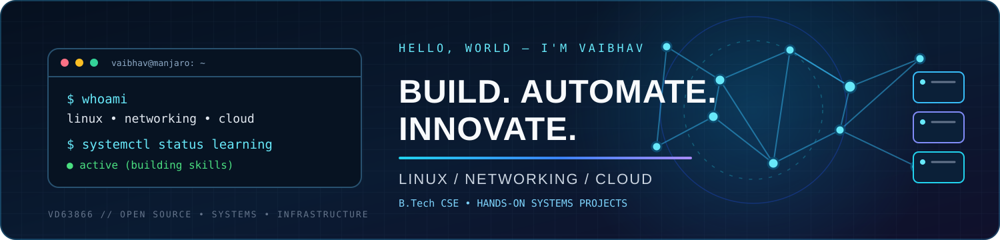

# Hi, I'm Vaibhav Dubey 👋

### B.Tech Computer Science Student | Aspiring Network Engineer & Linux Systems Administrator

I'm a computer science student interested in Linux systems, computer networking, and cloud infrastructure. I enjoy learning by building practical projects, troubleshooting systems, and automating everyday tasks.

I primarily work in **Manjaro Linux** and have also used **Arch Linux**. I'm currently strengthening my foundations in Linux administration and networking while exploring cloud and DevOps technologies.

---

## 👨‍💻 About Me

- 🐧 Linux user working with Manjaro and Arch Linux
- 🌐 Focused on learning computer networking and infrastructure
- ⚙️ Interested in Linux system administration and Bash automation
- ☁️ Exploring cloud computing and DevOps fundamentals
- 🛠️ Prefer hands-on labs, practical tools, and documented experiments
- 📚 Building my skills through personal and academic projects

## 🧰 Technologies & Tools

**Linux and Systems**
- Manjaro Linux, Arch Linux
- Pacman package manager
- systemd services and timers
- Bash scripting
- Linux command-line tools
- System monitoring and troubleshooting

**Networking — Learning**
- TCP/IP fundamentals
- IPv4 addressing and subnetting
- DNS and DHCP
- Routing and switching concepts
- Linux networking tools

**Programming and Development**
- Python
- Java
- Lua
- Git and GitHub

**Exploring**
- Cloud infrastructure
- Docker and containerization
- DevOps workflows
- Network automation

## 🚀 Projects

### 🌀 Fan Speed Manager
**Status: In Development**

A Linux project focused on laptop fan monitoring and exploring safe, hardware-supported fan management.

Development areas:
- Reading available fan-speed and temperature telemetry
- Investigating hardware and kernel interfaces
- Exploring supported fan-control mechanisms
- Designing safety checks and a user-friendly workflow

### 🎧 SonicBoost — Linux Audio Enhancer
**Status: In Development**

A minimal Linux desktop application aiming to provide system-wide audio enhancement.

Planned development areas:
- Linux audio-server integration
- Volume enhancement and equalizer controls
- Audio effects and processing
- Simple, approachable user interface

### 🐧 Manjaro Linux Automation Toolkit
**Status: In Progress**

A collection of practical Linux automation helpers built with Bash and systemd.

Current focus:
- System health reporting
- systemd services and timers
- Safe package-maintenance assistance
- System monitoring and developer workflow helpers

### 🎮 Lua Pong
**Status: Completed Learning Project**

An arcade-style Pong game built with Lua and LÖVE2D while learning game loops, collision detection, basic AI, and game-state management.

[View repository →](https://github.com/vd63866/love-pong)

## 🎯 Current Learning Goals

- Build a solid foundation in networking and TCP/IP
- Improve Linux administration and troubleshooting skills
- Create practical network and cloud labs
- Learn containerization and infrastructure automation
- Contribute to open-source projects and document what I learn

## 🤝 Connect

I'm always interested in learning from the open-source community and collaborating on projects related to Linux, networking, cloud infrastructure, and automation.

Thanks for visiting my profile!
